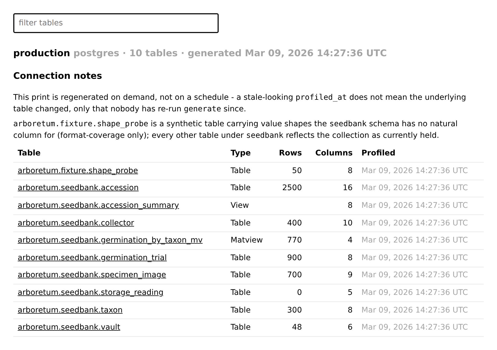
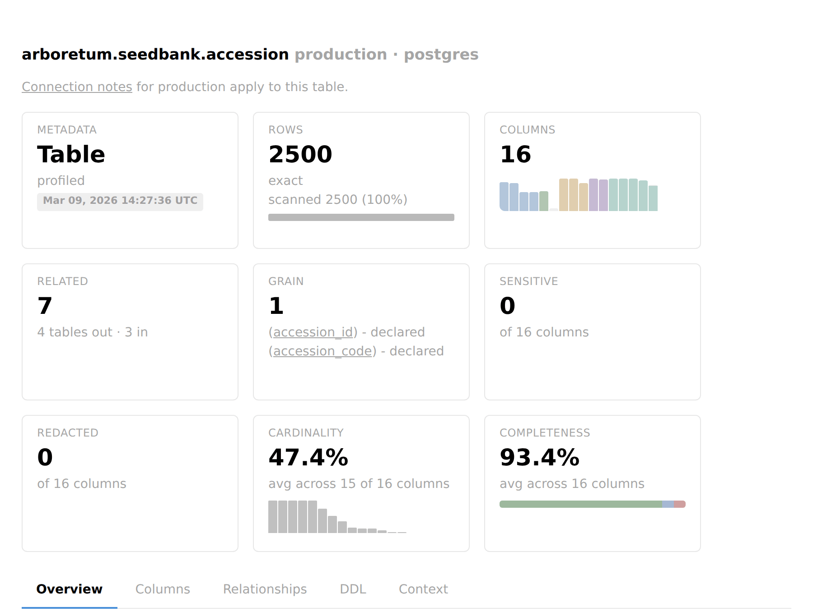
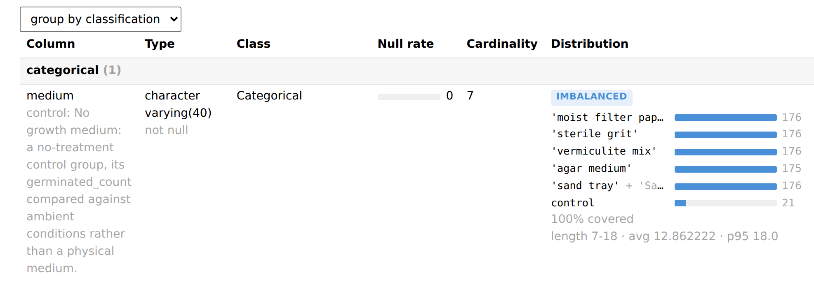
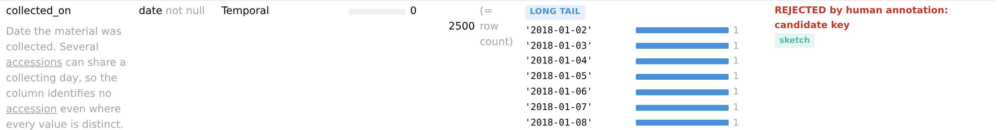
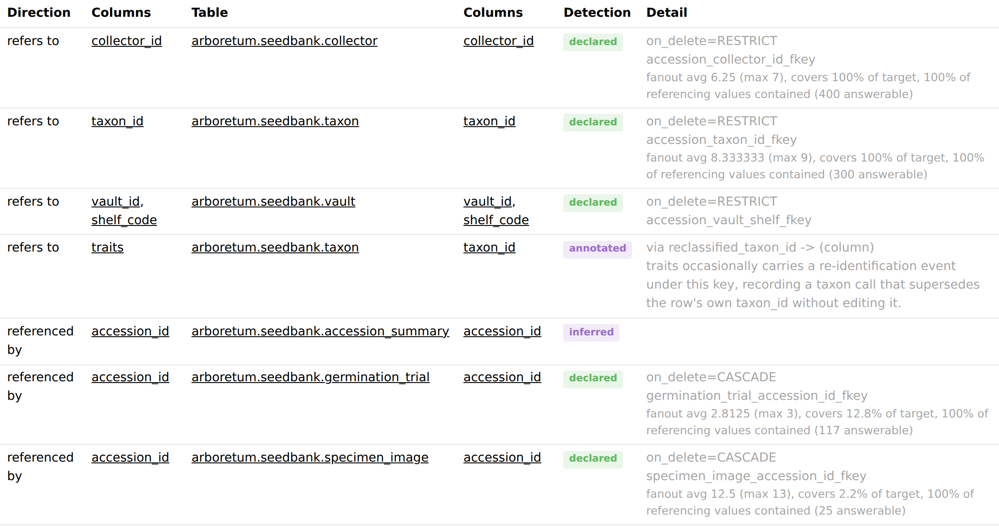
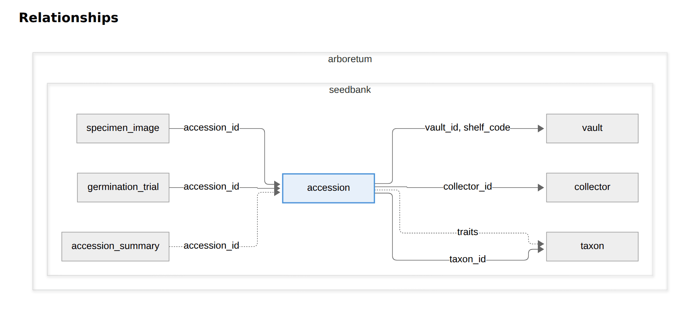

# Browsing a print

A print is plain text, and reading it in an editor works. But a print of any size is a lot of YAML, and the questions people actually arrive with — what is in this table, what joins to it, which columns are mostly null — are faster to answer by clicking than by scrolling.

`dbprint docs` renders a committed print as a small site: one page per table, one per schema, and an index. It needs no database, because everything it shows is already on disk.

```console
$ pip install 'dbprint[docs]'
$ dbprint docs serve
```

That binds `127.0.0.1:8765` and serves the connections the project resolves — the same resolution `generate` uses, so a bare invocation works wherever a bare `generate` does. `--host` accepts loopback addresses only; it answers only a loopback `Host`, so a web page that rebinds its own name to `127.0.0.1` reaches nothing either.

## What the pages show

| Page | Holds |
|---|---|
| Index | every connection served, its schemas, when each print was taken, and the connection's notes from `manifest.annotations.yaml` — every table page links to them |
| Schema | the tables in it, with row counts and column counts |
| Table | the full per-column surface, its relationships, and a diagram of the edges into and out of it |



The table page is the one worth knowing. It carries what `statistics.yaml` carries — classification, null rate, cardinality, value lists, ranges, percentiles — beside the prose from that table's `description.md` and `statistics.annotations.yaml`, so a measurement and the note correcting it appear together rather than in two files. Value bars spell each value as `dbprint context` does — `''` for an empty string, `'NULL'` for the stored word, `NULL` only for a genuine null — and a `drop`-redacted column's bars read `(value withheld)`. Descriptions and notes render as Markdown; raw HTML in them shows as text, and only web, mail and relative links are live.





A guess a person withdrew under `rejected` in `statistics.annotations.yaml` — a candidate key, a value shape, a sensitivity — stays in the column's Notes, marked `REJECTED by human annotation`, where `dbprint context` and the MCP server leave it out.



Three banners can appear above everything else, and they are deliberately distinct because absence and corruption read differently: `Missing: <kinds>` names a declared artifact that isn't on disk; `Unreadable: <kinds>` names one that is on disk but malformed — it failed to parse, or is an annotation file that does not match its schema; a catalog-only notice explains that no query was issued at all, so cardinality is not measured on this page.

A measurement the file's `disabled` list names gets a block of its own, quoting the list and stating what is unknown because configuration switched it off for this table — an absent null-pattern table or timeline there is not a finding about the data.

### Timeline and Depends on

Two sections in the overview panel read the newer per-table fields directly:

- **Timeline** — heading `Timeline - <column> by <unit>`, the anchor column linked to its own row. The hedge states the bucketed share as a percentage that keeps one more decimal wherever rounding would land a partial share on `0%` or `100%`, so a coverage under 1.0 never reads `100%`. It also reads `A missing bucket is a gap - no rows fell in that <unit>`, so an absent row between two present ones is a real gap, not a rendering skip. The block only appears when the file carries `timeline` at all — a scoped table or an empty one never shows it, since neither computed one.
- **Depends on** — hedged `Catalog-derived, direct dependencies only - a different relation than a foreign key`. Three states, and the page tells them apart: a non-empty list renders links to each object; an empty list renders `Reads nothing else printed`; the field omitted entirely (the producer could not ask) renders no section at all. The same names double as diagram edges, drawn with an open-circle head and a muted dashed style so a dependency edge can never be mistaken for a foreign key even without color.

### The column table's degenerate census

Beside the null-rate bar, a column carrying `zero_count`, `negative_count`, `non_finite_count` or `empty_count` shows a dot-separated line — `<n> zero`, `<n> negative`, `<n> non-finite`, `<n> empty` — under the null figure. Each sub-count is gated on being truthy, so an explicit `0` renders nothing there, reading the same as a field the classification forbids or the run never measured. If you need to tell those apart, read `statistics.yaml` directly for that column.

Further down the same cell: `mean`/`sum` render as `mean X · sum Y` whenever either is present, each spelled as `statistics.yaml` spells it (positional, never an exponent). Every count on the page is its exact integer, never compacted to `10K`. A redacted column carries neither, nor `length` or the degenerate counts above — a marked column publishes its count profile only — so its cell shows `bounds withheld` and the counts it keeps. A `length` block renders as `length <min>-<max> · avg <avg> · p95 <p95>`.

### The relationships panel

Every edge gets a Detection badge with one of four verdicts: `declared` (a real foreign key), `measured` (proposed from two columns' own sketches, never a schema fact), `inferred` (a naming guess), or `annotated` (an edge a human added in `relationships.annotations.yaml`, listed on both tables it joins, with nothing measured behind it) — an edge carrying no `detection` at all reads as `inferred`, never defaulted upward. `declared` and `measured` are two different claims and the page never blurs them: a declared edge is a constraint the database enforces; a measured one is evidence the data happens to join cleanly today.

Detail beside the badge carries whatever the edge can state — `on_delete`, a constraint name, the annotation path for a human-added edge — and, where the observed join was measured, its fanout, target coverage and containment, or `scopes not comparable` when the two sides' scopes can't be compared at all. A verdict a human annotation rejected renders `REJECTED by human annotation` on both the referencing and the referenced side; one addressing a declared edge is void and renders nothing.



The Overview draws the same edges as a diagram around the current table: a solid line is `declared`, a thick one `measured`, and a dotted one `inferred` or `annotated`. A rejected edge stays on it, faded red. Every table in the print is a link to its own page.



## What a `catalog_only` table shows

No query was issued, so the columns carry only catalog facts:

- The catalog-only banner renders at the top of the page.
- The related, data-through, sensitive, redacted, cardinality and completeness cards all vanish together — every one of them needs a query this table never ran.
- The rows card still shows the catalog's own row count, with no scanned-share line.
- The Overview still shows Description, Grain, Timeline, Depends on, Physical layout and Dependencies wherever the statistics file happens to carry them — a plain view is exactly where `depends_on` is expected to be present.
- The columns table still renders from the catalog-declared column list, with an empty null-rate figure and `n/a` cardinality on every row.

## What a scoped table shows

A table read over part of its rows — a `sample` or a `filter` — describes the rows scanned, not the table:

- The rows card shows the scanned count and its share of the table's row count, with the sample or filter that narrowed it.
- Every claim one unread row could falsify carries `over the rows scanned`: the data-through card's secondary line, a complete value list's `covered` line, a candidate key, and a freshness verdict.
- Counts, ratios, percentiles and bounds carry no clause of their own; the rows card already names their population.

## When a route fails to build

`dbprint docs build` writes every page it can and collects the routes it could not into a `failed: <route>` line on stderr, then exits `1`. Each page is written the moment it renders, before the next route is attempted, and the static assets and marker file go down last, after every route has been tried — so a partial build still leaves every page that did render usable — a failure narrows what's on disk, it does not corrupt what's there.

## Publishing it

To hand the site to people who will not install dbprint, build it as static files:

```console
$ dbprint docs build --output dbprint-docs
Wrote 6 pages to dbprint-docs
```

The output is self-contained — no CDN, no network at render time — so it works from a file share, an artifact store, or any static host. A built page depends on the print alone: it names no directory on the machine that built it, and a table's profiled time is the date itself rather than an age that would go stale once published.

`build` writes a `.dbprint-docs` marker into the directory it creates, and refuses to recreate a directory that does not carry one unless you pass `--force`. That is the guard against pointing `--output` at a directory holding something else. Add the output directory to `.gitignore`: it is derived from the print, and the print is what you commit.

## When to reach for this rather than the alternatives

Three surfaces read the same print, and they answer to different readers.

| Use | When |
|---|---|
| `dbprint docs` | a human is exploring, or onboarding, and does not know what they are looking for yet |
| `dbprint context` | a human or a pipeline needs a text fragment to paste into a prompt |
| the MCP server | an agent should fetch what it needs on its own — see [giving a print to an agent](agents.md) |

The site is the only one of the three built for browsing. The other two produce text for something else to consume.
